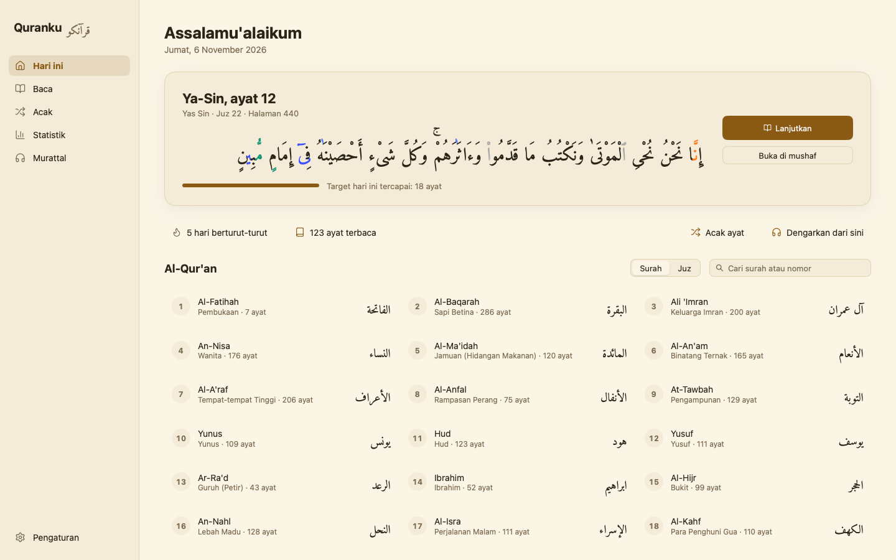
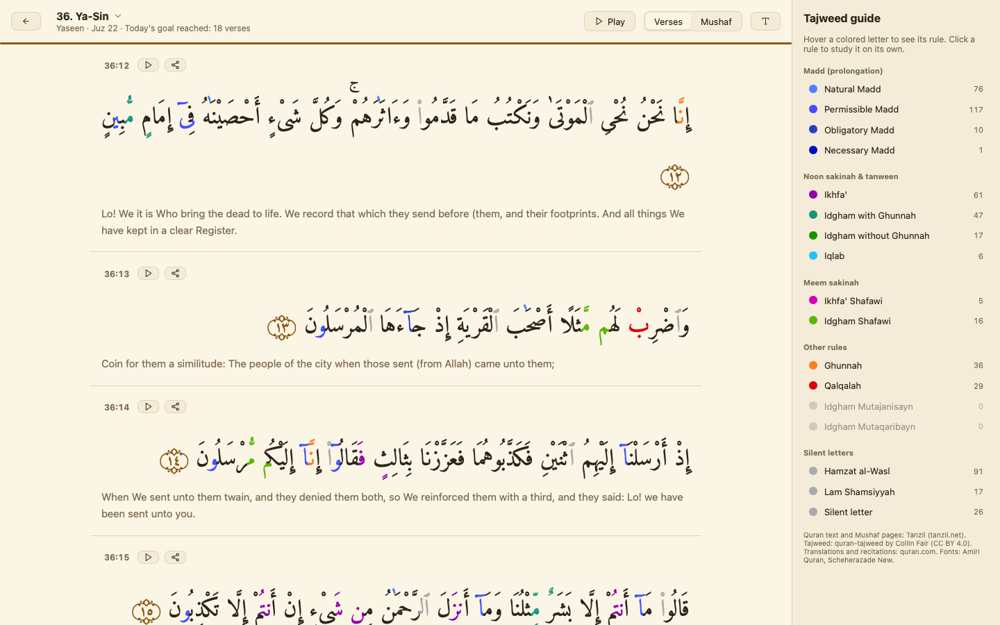
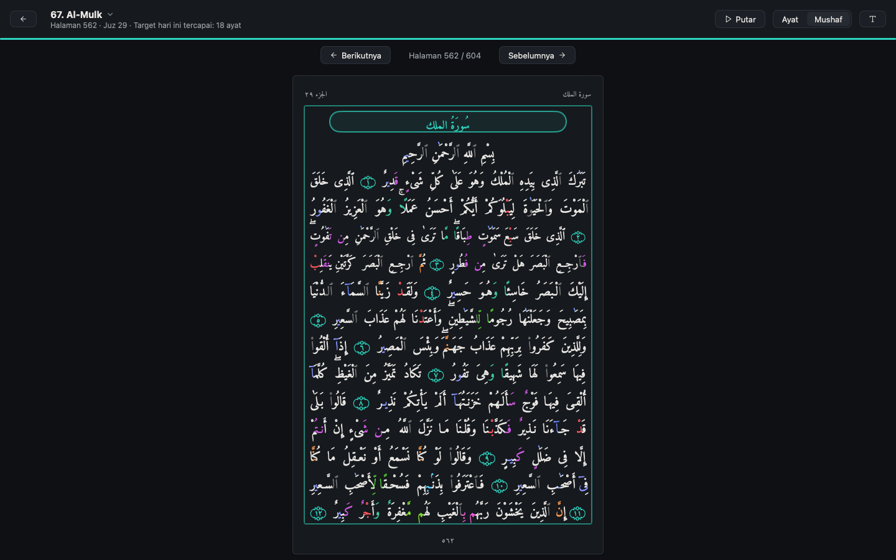
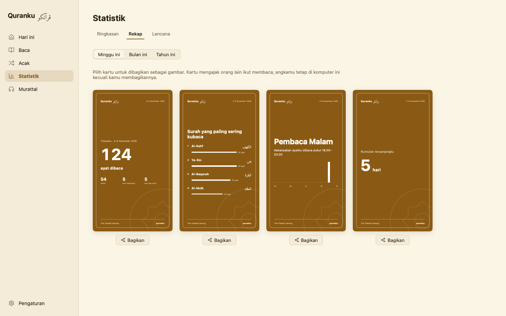
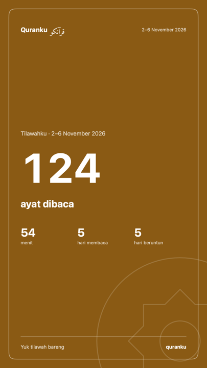
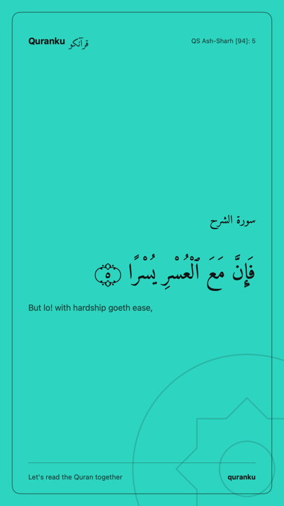

# Quranku · قرآنكو

A calm desktop Quran reader for a daily reading habit, with tajweed colors
you can hover to learn, the pages of the Madinah Mushaf, recitation that
follows along, and recaps worth sharing. Built in Go with
[MyGo](https://mygo.egoist.dev/) native UI.

> **Bahasa Indonesia:** Quranku adalah aplikasi Al-Qur'an desktop untuk
> tilawah harian: warna tajwid yang bisa diarahkan kursor untuk belajar,
> Mushaf Madinah baris per baris, murattal yang mengikuti bacaan, serta rekap
> dan kartu yang bisa dibagikan. Antarmuka tersedia dalam Bahasa Indonesia dan
> English.



## Features

- **Continue reading.** The app opens on today: the verse where you stopped,
  your daily goal, your streak. One click and you are reading.
- **Tajweed colors.** 17 rules colored from open tajweed annotations. Hover a
  colored letter to see the rule; click it to study that rule alone, with a
  guide beside the text.
- **Two ways to read.** Verse by verse with a translation, or the **Madinah
  Mushaf**: its 604 pages, each starting on the verse the printed page does,
  in 15 lines justified with kashida. One page or two side by side.
- **Recitation.** 12 reciters. Play from any verse; the verse recited is
  highlighted and followed, with repeat for memorization. Download surahs for
  offline listening. What plays shows in the system's media controls, and
  the media keys play, pause and skip verses.
- **Make it yours.** Five paper themes and your own from four colors, two
  Quran fonts, text size and line spacing (⌘+ / ⌘− / ⌘0 while reading), and
  126 translations to choose from.
- **Honest statistics.** A verse counts as read after it has been on screen,
  in reading order, for about half a second a word, once a day. Streaks,
  progress by juz, the last 14 days.
- **Recaps and share cards.** Weekly, monthly and yearly recaps (verses,
  top surahs, when you read, your streak and reciter) and verse cards, as
  1080×1920 story or 1080×1080 post images, in several styles.
- **Badges.** Twelve habits to keep, from a first verse to a khatam.
- **Shuffle.** A random verse, passage or page from the Quran, a juz or a
  surah, with a memorization test that hides the text.
- **Bilingual.** Bahasa Indonesia and English.

| Verse by verse | Mushaf |
|---|---|
|  |  |

| Recap | Share cards |
|---|---|
|  |   |

## Download

[Releases](https://github.com/ibrahimhnif/quranku/releases) have the app for
macOS (`.dmg`, Apple silicon and Intel), Windows (installer, or a portable
`.exe`) and Linux (AppImage, `.deb`, or a `.tar.gz` with `install.sh`).

The builds are not signed yet. On macOS, open the app the first time with
right-click → Open (or allow it in System Settings → Privacy & Security); on
Windows, choose "More info" → "Run anyway" when SmartScreen warns. On Linux
the app needs GTK 3, which desktops have.

A release is made by bumping `version` in `mygo.json` and pushing its tag
(`git tag v0.2.0 && git push origin v0.2.0`): the Release workflow builds
every platform and publishes them.

## Build and run

You need Go (see `go.mod` for the version) and macOS, Windows or Linux.
The project's MyGo CLI is a Go tool, so nothing else is installed.

```sh
go tool mygo dev      # run, rebuilding as the code changes
go test ./...         # the tests (run on macOS in CI)
go tool mygo build    # package the app into build/
```

With [devbox](https://www.jetify.com/devbox), `devbox shell` provides Go.

On first run Quranku asks five quick questions (language, reading style,
look, reciter, daily goal); everything can be changed later in Settings.

### Data

The Quran text, its tajweed rules, the Mushaf's pages and Pickthall's English
translation are in `data/` and built into the app, all under open terms (see
[NOTICE.md](NOTICE.md)):

- `quran-uthmani.txt`, `quran-data.js`: Tanzil's Uthmani text and metadata,
  verbatim.
- `tajweed.json`: Collin Fair's tajweed annotations, moved onto that text by
  `python3 scripts/build_tajweed.py`.
- `en.pickthall.txt`: Pickthall's translation (1930), in the public domain.

The Mushaf's line breaks are Quranku's own: each page holds the verses of the
printed page, spread evenly over its 15 lines.

Recitations and other translations (Kemenag RI's Indonesian among them,
fetched when the app is in Indonesian) are downloaded at runtime into the app's
user data folder, with `settings.json` and `stats.json`. Nothing leaves your
computer unless you save or copy a share card yourself.

## Project layout

| File | What it holds |
|---|---|
| `main.go` | App state, sections, reader bar, sidebar |
| `home.go`, `onboarding.go`, `settings_page.go` | Home, first run, settings |
| `reader.go`, `mushaf.go`, `mushaf_view.go`, `kashida.go` | Verse reader, Mushaf layout and justification |
| `quran.go`, `tajweed.go` | Text loading, tajweed markup and rules |
| `recitation.go`, `translations.go`, `net.go` | Audio, translations, downloads |
| `stats.go`, `recap.go`, `badges.go`, `sharecard.go` | Statistics, recaps, badges, share cards |
| `themes.go`, `customize.go`, `fonts.go`, `icons.go` | Look and feel |
| `PRODUCT.md`, `DESIGN.md` | Product brief and design system |

## Notes

- Fonts are limited to those macOS Core Text shapes correctly. The printed
  Madinah fonts (KFGQPC Uthmanic Hafs, Digital Khatt) need HarfBuzz and lose
  their vowel marks under Core Text, so Quranku uses Amiri Quran and
  Scheherazade New.
- The tajweed explanations are short summaries; check them with a teacher
  before relying on them for teaching. Corrections are welcome.

## Contributing

Issues and pull requests are welcome, especially corrections to tajweed
explanations and translations of the interface. Run `gofmt`, `go vet` and
`go test ./...` before sending a change.

## License

The code is under the [MIT License](LICENSE). The Quran text, translations,
layout data, fonts and icons keep their own terms: see [NOTICE.md](NOTICE.md).
Quran text and Mushaf pages: [Tanzil](https://tanzil.net). Tajweed:
[quran-tajweed](https://github.com/cpfair/quran-tajweed). Downloaded
translations and recitations: [quran.com](https://quran.com).
